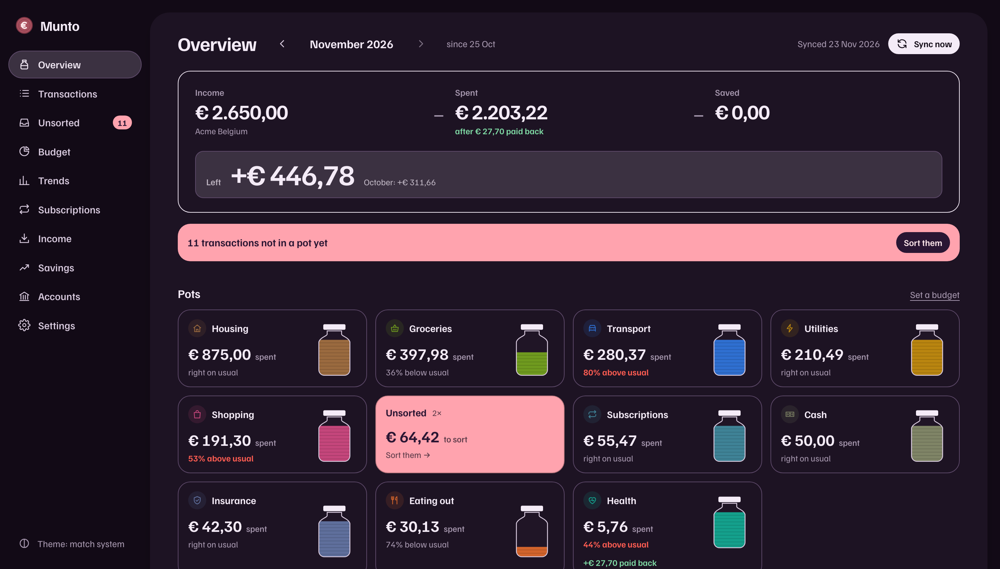
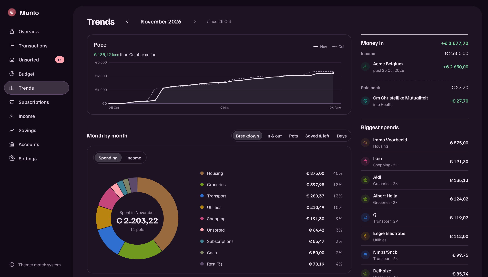
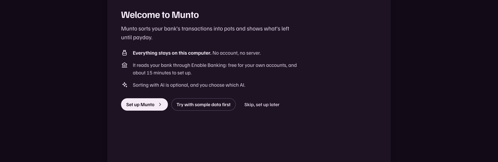

# Munto

**Budgeting that stays on your computer.** Munto reads your bank account, sorts every payment into pots, and
shows what's left until payday. There's no Munto account and no cloud: your transactions live in one file on
your own computer.



## What it does

- **What's left until payday.** Your month runs from salary to salary, as one line: *Income − Spent − Saved =
  Left*. Every pot (Groceries, Transport, Eating out…) is a jar that fills as you spend, against what's usual
  for you or against your budget.
- **It sorts itself.** Rules put known merchants in their pot. What's left waits in *Unsorted*, one merchant at
  a time, and becomes a rule once you pick a pot. An AI of your choice can suggest the pots; you approve them.
- **Budgets that learn.** Suggested from your own months, with funds for the big yearly bills, a look back at
  how last month went, and a check against 50/30/20.
- **Subscriptions, savings and tips.** What's due before payday, where your savings plan takes you in 1–20
  years, and where you could cut, with a yearly figure for each.
- **It runs by itself.** It syncs every morning and tells you about new transactions, and about bank access
  that's about to end.



## Your data stays yours

- **Everything is stored on your computer**, in your own data folder. No account, no server, no analytics.
- **Your bank is read, never written to.** Munto reads your accounts through [Enable Banking](https://enablebanking.com),
  a licensed PSD2 provider, with an application you register yourself, free for your own accounts. It can't
  move money.
- **AI is off until you choose one**, and then sees merchant names and amounts, never your IBAN or balances.
  With Ollama it all stays on your computer.
- Besides your bank (through Enable Banking) and the AI you choose, the only thing Munto contacts is GitHub,
  to check for updates. The details, and the known limits, are in [SECURITY.md](SECURITY.md).

## Get started

**Download** the desktop app for macOS, Windows or Linux from the
[Releases](https://github.com/Arno-Boenders/munto/releases) page. The downloads aren't signed yet, so the first
time:
- **macOS:** take `-arm64.dmg` for Apple Silicon or `-x64.dmg` for an Intel Mac, and drag Munto to Applications.
  When macOS says it can't check it, open System Settings → Privacy & Security and click **Open Anyway**.
- **Windows:** `Munto-Setup-….exe` installs it for you, no admin rights. If SmartScreen warns, click **More info
  → Run anyway**.
- **Linux:** the `.AppImage` (make it executable and run it) or the `.deb`.

**Or run it from source**, with [Node](https://nodejs.org) 22.13 or newer and git:

```sh
git clone https://github.com/Arno-Boenders/munto.git
cd munto
npm install
npm run ui              # then open http://localhost:4000
```

`npm run app:install` builds the desktop app on your own computer instead, so your system doesn't warn about
an unknown developer.

The first start opens the setup guide. **Try with sample data first** shows Munto with three months of made-up
transactions, so you can look around before connecting anything.



## Connecting your bank

The setup guide walks you through it, in about 15 minutes:

1. Create a free [Enable Banking](https://enablebanking.com) account, and register an application in its control
   panel (the guide gives you the exact settings).
2. Activate *restricted mode*, free for your own accounts, and link the accounts you want to use.
3. Give Munto your application's ID and key file. It checks them with Enable Banking before saving them, in
   your data folder, readable only by you.
4. Connect your bank: approve read-only access at your bank, and your transactions come in.

Access lasts 90 to 180 days, depending on the bank. Munto tells you a week before, and renewing keeps
everything.

**No Enable Banking, or history from before?** Export your transactions as CSV from your bank and use
**Import a CSV** on the Accounts page. It reads any bank's export: you check the columns in a preview before
anything is saved.

## Good to know

- **Made in Belgium.** It's built and used with Belgian banks, in euro. Enable Banking covers most of Europe,
  and you choose your country in setup, but the interface is English and amounts are shown the Belgian way
  (€ 1.234,56). Other languages and currencies are on the [roadmap](ROADMAP.md).
- **Your data folder** (`~/Library/Application Support/Munto` on macOS, `%APPDATA%\Munto` on Windows,
  `~/.local/share/munto` on Linux) holds everything that's yours. Back it up by copying it; the desktop app
  also makes a backup every day.
- **It's young.** Munto is a personal project in active development. It works every day for its author, but
  expect rough edges, and keep backups.

## More

- **[The guide](docs/guide.md):** every page in detail, how sorting and months work, CSV import, the daily
  sync, the command line, the desktop app and the database.
- **[Contributing](CONTRIBUTING.md):** running it with sample data, how the code fits together, and the one rule
  about real data.
- **[Security](SECURITY.md):** what stays on your computer, what leaves it, and how to report a problem.
- **[Roadmap](ROADMAP.md):** what's built and what's next.

## Licence

Munto is free to use, study, change and share for any **noncommercial** purpose: for yourself, to learn
from, or in a non-profit, school or public body. Selling it, or using it in a paid product or service, isn't
allowed. Whoever passes on a copy, changed or not, keeps the copyright notice and these terms with it. The
exact terms are the [PolyForm Noncommercial License 1.0.0](LICENSE).

That makes Munto *source-available* rather than open source in the strict sense. For a use the licence
doesn't cover, ask.

The Familjen Grotesk font is under the SIL Open Font License (`app/fonts/OFL-familjen-grotesk.txt`).
